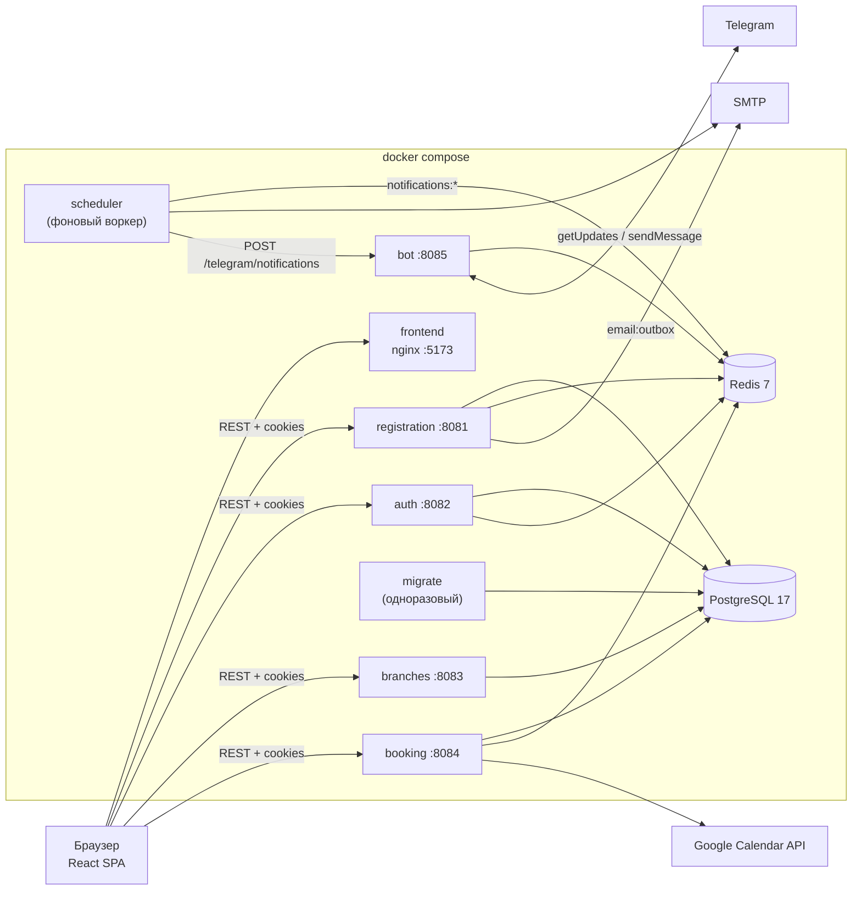
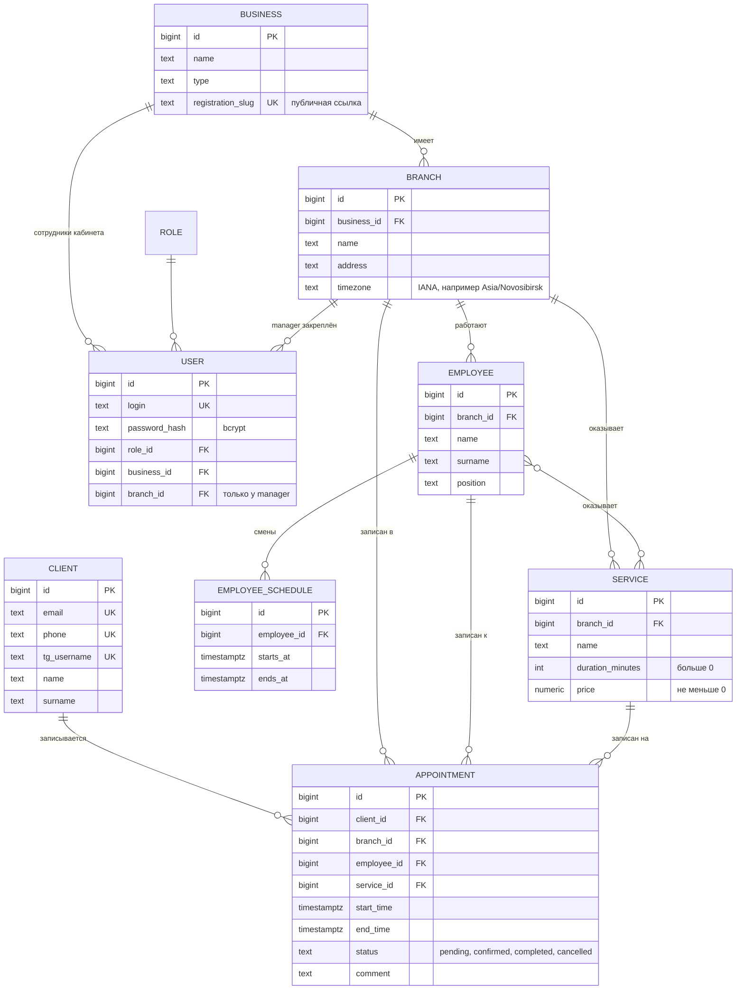

# Отчёт: Online Queue Management System

Система онлайн-записи в очередь к бизнесам сферы услуг: клиент записывается по публичной ссылке без регистрации, бизнес управляет филиалами и записями в личном кабинете, система напоминает клиенту о визите по email и в Telegram.

Содержание:

1. [Доменная область](#1-доменная-область)
2. [Стек реализации](#2-стек-реализации)
3. [Архитектура](#3-архитектура)
4. [Основные сущности доменной области](#4-основные-сущности-доменной-области)
5. [Соответствие методологии 12 факторов](#5-соответствие-методологии-12-факторов)

Инструкция по запуску - в [README.md](README.md).

---

## 1. Доменная область

**Проблема.** Небольшие бизнесы сферы услуг (салоны, клиники, сервисные центры) с несколькими филиалами ведут запись клиентов по телефону или в мессенджерах. Возникают накладки по времени мастеров, клиенты забывают о визитах, у администратора нет общей картины по филиалам.

**Решение - SaaS для онлайн-записи.** Бизнес регистрируется в системе, заводит филиалы, услуги и сотрудников с расписанием и получает **публичную ссылку** вида `/public/<slug>`. По ней клиент сам выбирает свободное время.

### Участники

| Роль | Кто это | Что делает |
|---|---|---|
| Клиент | посетитель бизнеса, без учётной записи | записывается по публичной ссылке, получает напоминания, добавляет запись в календарь |
| `business_admin` | владелец бизнеса | регистрирует бизнес, видит все филиалы, клиентов, записи, отменяет записи |
| `manager` | управляющий филиалом | то же, что администратор, но только в своём филиале |
| `super_admin`, `employee` | заведены в справочнике ролей | зарезервированы под развитие, отдельных сценариев нет |

### Основные сценарии

1. **Регистрация бизнеса:** email и пароль -> код подтверждения на почту -> бизнес и его администратор создаются в БД.
2. **Вход в кабинет:** логин и пароль -> JWT в HTTP-only cookie, обновление по refresh-токену.
3. **Публичная запись клиента:** выбор услуги -> выбор филиала -> выбор мастера -> выбор свободного слота -> ввод контактных данных -> запись создана. Пересечение записей у мастера запрещено на уровне БД.
4. **Напоминания:** за 24 часа и за 1 час до визита. Email уходит, если клиент указал почту, Telegram - если указал телефон или username и написал боту.
5. **Добавление в календарь:** скачать `.ics`, открыть шаблон события в Google Календаре или сохранить событие автоматически через Google OAuth.
6. **Кабинет:** филиалы, клиенты филиала, записи филиала, отмена записи.
7. **Восстановление пароля:** код на почту -> временный пароль на почту.

---

## 2. Стек реализации

| Слой | Технологии |
|---|---|
| Backend | **Go 1.27**, стандартный `net/http` (маршрутизация `ServeMux` с методами и шаблонами путей), `log/slog` (структурные JSON-логи) |
| Доступ к данным | `pgx/v5` (PostgreSQL, чистый SQL без ORM), `go-redis/v9` |
| Миграции | `pressly/goose/v3`, SQL-миграции в `migrations/` |
| Аутентификация | `golang-jwt/jwt/v5` (access и refresh JWT), `bcrypt` (`golang.org/x/crypto`) |
| Интеграции | SMTP (`go-mail/mail/v2`), Telegram Bot API (HTTP-клиент), Google Calendar API + OAuth 2.0 (`golang.org/x/oauth2`), iCalendar RFC 5545 |
| БД | **PostgreSQL 17** (`EXCLUDE`-ограничение на `btree_gist`, `timestamptz`, часовые пояса филиалов) |
| Очереди и состояние | **Redis 7**: Streams + consumer groups (письма), sorted sets + Lua (напоминания), ключи с TTL (сессии, коды, OAuth-state), распределённая блокировка (лидер Telegram-поллера) |
| Frontend | **React 19**, Vite 8, React Router 7, TanStack Query 5, Axios, Tailwind CSS 4 |
| Контейнеры | Docker: многоэтапные сборки, `golang:1.27-alpine` -> `alpine:3.24`, `node:22-alpine` -> `nginx-unprivileged`; базовые образы закреплены по `sha256`, процессы работают не от root |
| Запуск | Docker Compose, один файл `docker-compose.yml` |
| Тесты | `go test` (юнит-тесты, Redis в памяти - `miniredis`) |

---

## 3. Архитектура

Монорепозиторий из Go-микросервисов и SPA. Сервисы общаются по HTTP напрямую (без gateway и брокера сообщений); асинхронное взаимодействие идёт через Redis.

### Сервисы

| Сервис | Порт | Назначение | Хранилища |
|---|---|---|---|
| `registration` | 8081 | регистрация бизнеса по коду из письма, восстановление пароля; воркеры отправки писем | Postgres, Redis |
| `auth` | 8082 | вход, выпуск и обновление JWT, выход, `GET /auth/me` | Postgres, Redis |
| `branches` | 8083 | кабинет: филиалы, сотрудники, услуги, клиенты и записи филиала; публичные справочники для записи | Postgres |
| `booking` | 8084 | расчёт свободных слотов, создание и отмена записей, экспорт в календарь, постановка напоминаний | Postgres, Redis |
| `bot` | 8085 | Telegram-бот: привязка чата к телефону или username, отправка напоминаний | Redis |
| `scheduler` | - | фоновый воркер: доставляет созревшие напоминания по email и через bot | Redis |
| `migrate` | - | одноразовый процесс применения миграций (goose) | Postgres |
| `frontend` | 5173 -> 8080 | SPA, раздаётся nginx; адреса API берутся из env при старте контейнера | - |

Подробное описание endpoints: [`docs/REST_API.md`](docs/REST_API.md), сценарий публичной записи: [`docs/PUBLIC_BOOKING_API.md`](docs/PUBLIC_BOOKING_API.md).

### Основные endpoints

| Сервис | Endpoints |
|---|---|
| registration | `POST /register`, `POST /verify`, `POST /resend`, `POST /password-recovery`, `POST /password-recovery/confirm` |
| auth | `POST /auth/login`, `POST /auth/refresh`, `POST /auth/logout`, `GET /auth/me` |
| branches (кабинет, JWT) | `GET /branches`, `GET /branches/{id}/employees`, `GET /branches/{id}/clients`, `GET /branches/{id}/bookings`, `GET /services`, `GET /businesses/{id}/registration-slug` |
| branches (публичные) | `GET /public/{slug}/services`, `.../services/{serviceId}/branches`, `.../branches/{branchId}/employees` |
| booking (публичные) | `GET /public/{slug}/services/{serviceId}/branches/{branchId}/employees/{employeeId}/slots?date=`, `POST /public/{slug}/appointments`, `GET /public/appointments/{id}/calendar.ics`, `GET /public/appointments/{id}/google-calendar/auth-url` |
| booking (кабинет, JWT) | `GET /employees/{id}/appointments`, `GET /appointments/{id}`, `PATCH /appointments/{id}/cancel`, `GET /google-calendar/auth-url`, `POST /appointments/{id}/google-calendar` |
| booking (OAuth) | `GET /google-calendar/callback` - редирект обратно на фронтенд |
| bot | `POST /telegram/notifications` (вызывает scheduler) |
| все HTTP-сервисы | `GET /health` |

### Как запросы проходят через систему

- **Аутентификация.** `auth` выпускает access-JWT и refresh-JWT (время жизни - `ACCESS_TOKEN_TTL` и `REFRESH_TOKEN_TTL`, в `.env.example` 15 минут и 7 дней) в HTTP-only cookie; refresh-сессия хранится в Redis (`auth:refresh:<jti>`) и удаляется при выходе. Остальные сервисы проверяют access-токен локально общим middleware `libs/auth` и проверяют права по `role`, `business_id`, `branch_id` из claims. На фронтенде axios при `401` один раз (single-flight) обновляет токен и повторяет запрос.
- **Публичная запись.** Справочники отдаёт `branches`, слоты и создание записи - `booking`. Слоты считает SQL-запрос: окна расписания мастера с шагом 15 минут минус занятые записи, с учётом часового пояса филиала. Каждое обращение проверяет, что филиал, услуга и мастер принадлежат бизнесу с этим `slug`.
- **Напоминания.** `booking` при создании записи кладёт задачи в Redis (`notification:<id>` + sorted set `notifications:scheduled`); `scheduler` забирает созревшие и отправляет: email - сам через SMTP, Telegram - через `bot`.
- **Письма регистрации.** `registration` пишет письмо в Redis Stream `email:outbox`; его же воркеры отправляют письма через consumer group.

### Ключи Redis

| Ключ | Сервис | Назначение |
|---|---|---|
| `auth:refresh:<jti>` | auth | refresh-сессия, TTL = `REFRESH_TOKEN_TTL` |
| `registration:pending...`, `registration:recovery...` | registration | незавершённая регистрация и восстановление пароля, TTL 10 мин; код проверяется Lua-скриптом |
| `email:outbox`, `email:dead` | registration | Stream исходящих писем (consumer group `email-senders`) и письма, исчерпавшие попытки |
| `notification:<id>` | booking -> scheduler | данные напоминания; после отправки хранится 7 дней |
| `notifications:scheduled`, `notifications:processing` | booking, scheduler | расписание (score - время отправки) и задачи в работе (score - дедлайн аренды) |
| `telegram:phone:*`, `telegram:username:*`, `telegram:chat:*` | bot | привязка телефона или username к чату Telegram |
| `telegram:poller:leader`, `telegram:poller:offset` | bot | блокировка лидера поллинга (TTL 30 с) и offset обновлений Telegram |
| `google-calendar:*` | booking | OAuth state (10 мин), токены Google, токен экспорта записи (7 дней) |

---

## 4. Основные сущности доменной области

| Сущность | Описание | Важные правила |
|---|---|---|
| **Business** (бизнес) | компания-клиент SaaS, корень мультиарендности | `registration_slug` уникален и задаёт публичную ссылку `/public/<slug>`; все данные кабинета фильтруются по `business_id` из JWT |
| **Branch** (филиал) | точка оказания услуг | хранит часовой пояс: слоты считаются в локальном времени филиала, хранятся в UTC (`timestamptz`) |
| **User** (пользователь кабинета) | `business_admin` или `manager` | логин уникален, пароль - bcrypt; у менеджера `branch_id`, и доступ ограничен этим филиалом |
| **Role** (роль) | `super_admin`, `business_admin`, `manager`, `employee` | заполняется миграцией |
| **Employee** (мастер) | сотрудник филиала, к которому записываются | оказывает только услуги из `employee_services` |
| **EmployeeSchedule** (смена) | интервал работы мастера `[starts_at, ends_at)` | `ends_at > starts_at`, смены одного мастера уникальны |
| **Service** (услуга) | услуга филиала с длительностью и ценой | длительность определяет длину записи и сетку слотов |
| **Client** (клиент) | человек, записавшийся по публичной ссылке, без учётной записи | email, телефон и Telegram username уникальны: повторная запись находит существующего клиента |
| **Appointment** (запись) | визит клиента к мастеру на услугу | `end_time > start_time`; статус из 4 значений; **`EXCLUDE USING gist (employee_id WITH =, tstzrange(start_time, end_time) WITH &&) WHERE status IN ('pending','confirmed')`** - PostgreSQL сам не даст создать пересекающиеся активные записи одного мастера даже при одновременных запросах |

Сущности, живущие в Redis:

| Сущность | Описание |
|---|---|
| **Notification** (напоминание) | задача "отправить напоминание о записи по каналу email или telegram в момент T"; статусы `scheduled -> (retrying) -> sent / failed` |
| **Email message** (письмо) | код подтверждения, код восстановления, временный пароль - элемент Redis Stream |
| **Pending registration / Password recovery** | незавершённая регистрация или восстановление: код и данные, живут 10 минут |
| **Refresh session** | сессия входа, удаляется при выходе |
| **Telegram binding** | связь "телефон или username = chat_id", создаётся, когда клиент пишет боту |

---

## 5. Соответствие методологии 12 факторов

| # | Фактор | Выполнен |
|---|---|---|
| I | Кодовая база | + |
| II | Зависимости | + |
| III | Конфигурация | + |
| IV | Сторонние службы | + |
| V | Сборка, релиз, выполнение | + |
| VI | Процессы | + |
| VII | Привязка портов | + |
| VIII | Параллелизм | + |
| IX | Утилизируемость | + |
| X | Паритет разработки и эксплуатации | + |
| XI | Журналирование | + |
| XII | Задачи администрирования | + |

### I. Кодовая база

Один git-репозиторий, из которого собираются все сервисы; развертываний может быть сколько угодно, отличаются они только `.env`. Это монорепозиторий: сервисы и общий каталог `libs/` лежат в одном модуле Go. Систему мы рассматриваем как одно распределенное приложение: сервисы меняются вместе, `libs/` - внутренние пакеты этого приложения. При этом каждый сервис - отдельный процесс и отдельный образ (`services/<svc>/<svc>.Dockerfile`).

### II. Зависимости

- Go-зависимости зафиксированы в `go.mod` и `go.sum`, фронтенд - в `package.json` и `package-lock.json` (`npm ci`).
- Системные зависимости описаны в Dockerfile: базовые образы закреплены по `sha256`, в runtime-образ явно ставятся `ca-certificates` и `tzdata`.
- Сервисы - статические бинарники (`CGO_ENABLED=0`) в минимальных alpine-образах, ничего не берется из окружения хоста.

### III. Конфигурация

- Все, что отличается между окружениями (адреса и пароли БД и Redis, SMTP, JWT-секреты, порты, CORS, ключи Google, токен Telegram), читается из переменных окружения через `libs/config`. Если обязательной переменной нет, сервис не стартует.
- Полный список ключей без секретов - `.env.example`; реальный `.env` в git не попадает. Секреты не пишутся в логи.
- Фронтенд тоже настраивается окружением: при старте контейнера `frontend/docker/40-app-config.sh` генерирует `/config.js` с адресами API, поэтому один образ работает в любом окружении.

### IV. Сторонние службы

PostgreSQL, Redis, SMTP, Telegram Bot API и Google API подключаются только по адресам и учетным данным из env (`DB_HOST`, `REDIS_ADDR`, `SMTP_HOST`, токены). Заменить локальный Postgres на внешний - значит поменять `.env`, код не меняется. Недоступность службы не роняет систему: письма и напоминания остаются в Redis и повторяются, без ключей Google работает `.ics`, без токена Telegram бот стартует в режиме "только HTTP".

### V. Сборка, релиз, выполнение

- **Сборка:** `docker compose build` - многоэтапные Dockerfile превращают код в образы.
- **Релиз:** собранные образы + конфигурация из `.env`.
- **Выполнение:** `docker compose up -d` запускает процессы из готовых образов; код в работающем контейнере не меняется, любое изменение требует новой сборки.

### VI. Процессы

Процессы не хранят в памяти ничего, что должно пережить перезапуск, все состояние - в Postgres и Redis:
- аутентификация - JWT в cookie, refresh-сессии в Redis;
- очередь писем - Redis Stream `email:outbox` с consumer group (раньше был канал Go в памяти);
- напоминания всегда лежат в Redis (`notifications:scheduled` или `notifications:processing`), задачи забирает атомарный Lua-скрипт;
- offset Telegram-бота и временные коды тоже в Redis.

### VII. Привязка портов

Каждый Go-сервис - самостоятельный HTTP-сервер на `net/http`, порт берется из env (`AUTH_PORT`, `BOOKING_PORT` и т.д.). Фронтенд - образ со своим nginx на порту 8080. Сервисы обращаются друг к другу по URL (`scheduler` -> `BOT_URL`).

### VIII. Параллелизм

- HTTP-сервисы stateless и могут работать в нескольких экземплярах.
- Воркеры писем: несколько горутин и любое число реплик, consumer group выдает каждое письмо одному воркеру.
- `scheduler`: `--scale scheduler=N`, Lua-скрипт атомарно забирает задачи, каждое напоминание отправляется один раз.
- `bot`: `--scale bot=N`; Telegram допускает только одного читателя `getUpdates`, поэтому реплики выбирают лидера через Redis-блокировку (`SET NX PX`), а отправлять уведомления могут все.
- В compose нет `container_name`, чтобы реплики могли запускаться.

### IX. Утилизируемость

- Статические Go-бинарники стартуют за доли секунды.
- Все сервисы ловят SIGTERM/SIGINT (`signal.NotifyContext`) и завершают текущие запросы (`http.Server.Shutdown`).
- При внезапной смерти процесса задачи не теряются: неподтвержденные письма забирает другой воркер (`XAUTOCLAIM`), напоминания возвращаются в очередь по истечении аренды, блокировка лидера бота истекает за 30 с.
- `migrate` идемпотентен.

### X. Паритет разработки и эксплуатации

Везде используются одни и те же Dockerfile, один `docker-compose.yml` и те же версии Postgres 17 и Redis 7 (закреплены по `sha256`), без SQLite или in-memory подмен. Окружения отличаются только значениями в `.env`, набор ключей общий (`.env.example`).

### XI. Журналирование

Все сервисы пишут логи только в stdout одной JSON-строкой на событие (`libs/logger`), без файлов и без отправки из кода. Сбором занимается окружение (`docker compose logs`). Каждый HTTP-запрос логируется middleware с `request_id`, методом, путем, статусом и длительностью.

### XII. Задачи администрирования

Миграции БД выполняет отдельный одноразовый процесс `migrate`, собранный из того же кода и запускаемый с тем же `.env`. В compose он стартует перед сервисами, которым нужна БД, и завершается; вручную - `docker compose run --rm migrate`. Разовые операции с данными - `docker compose exec postgres psql ...`.
